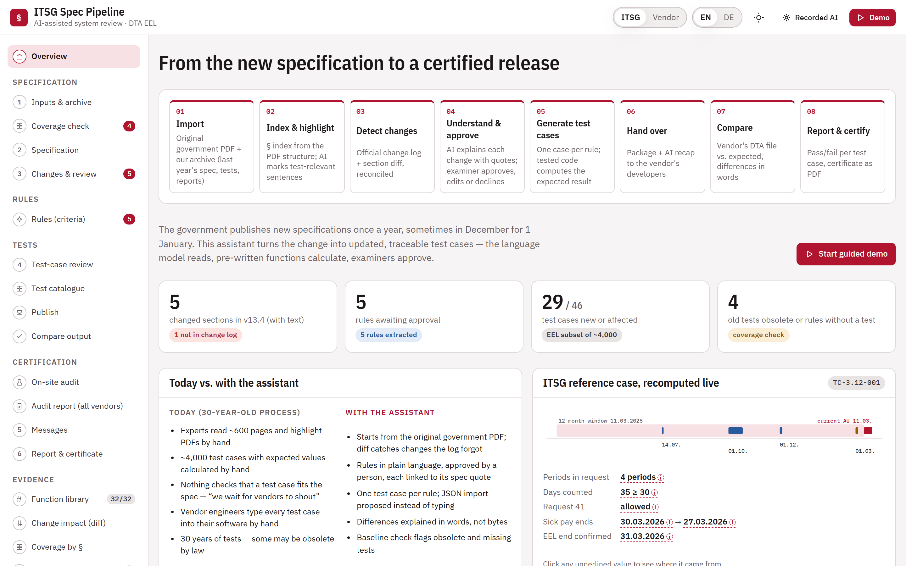
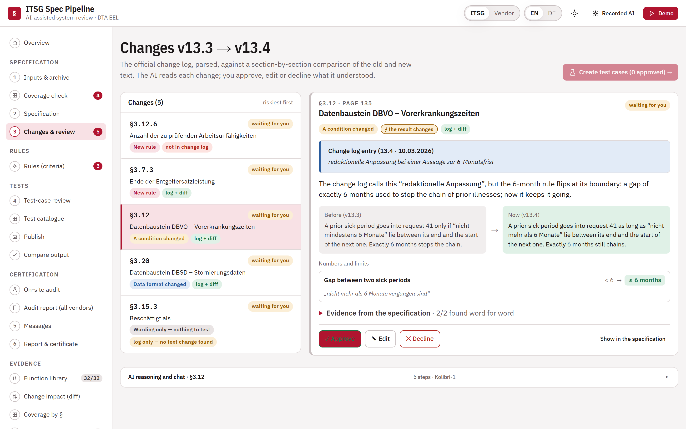
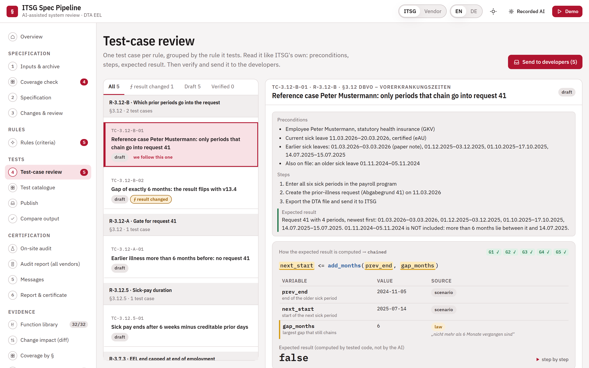
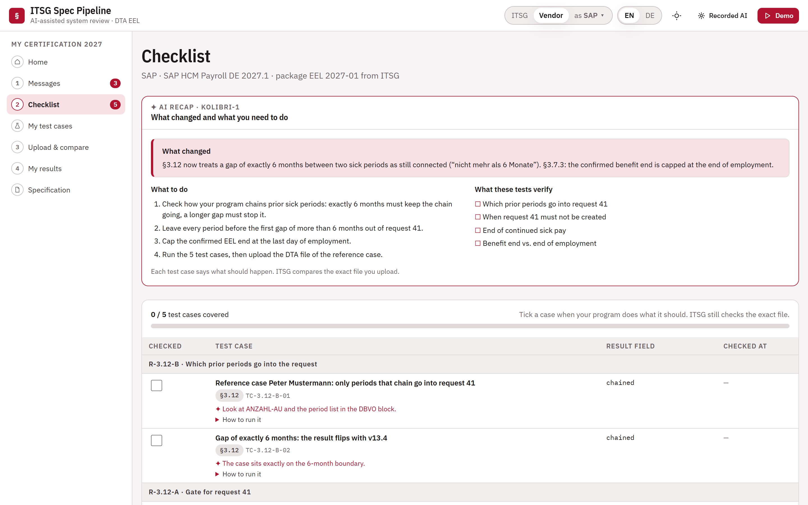
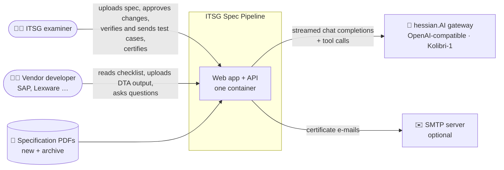
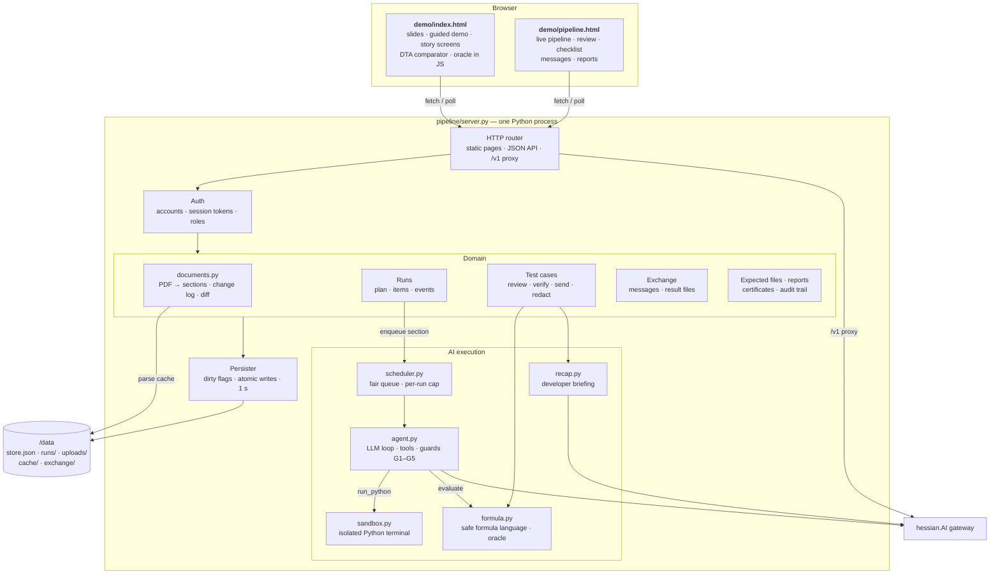
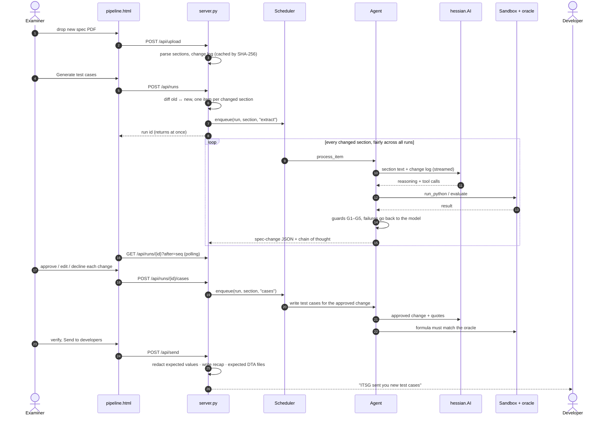
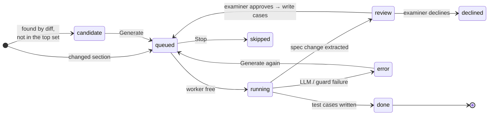
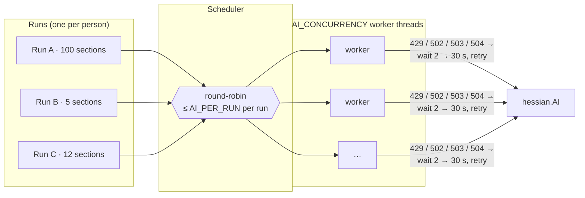
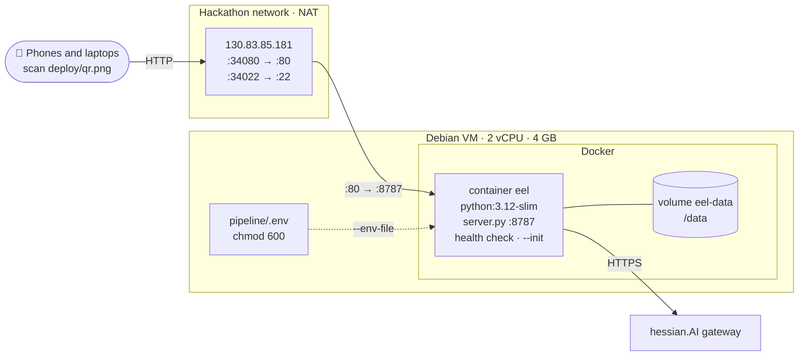

<div align="center">


# ITSG Spec Pipeline

**From the new specification to a certified release — with AI that shows its work.**

An AI review assistant for ITSG's system review of German payroll software,<br>
built at **Futury Build Days #3** (26–27 Oct 2026) · challenge sponsor **ITSG** · tech sponsor **hessian.AI**


[**Quick start**](#-quick-start) · [**Architecture**](#-architecture) · [**How it works**](#-how-it-works) · [**Trust model**](#-trust-model) · [**Docs**](#-documentation)



</div>

---

## 📖 Contents

- [About](#-about)
- [Highlights](#-highlights)
- [Screenshots](#-screenshots)
- [Quick start](#-quick-start)
- [Architecture](#-architecture)
  - [System context](#system-context)
  - [Components](#components)
  - [An AI run, end to end](#an-ai-run-end-to-end)
  - [Life of a spec section](#life-of-a-spec-section)
  - [Concurrency model](#concurrency-model)
  - [Deployment](#deployment)
- [How it works](#-how-it-works)
- [Trust model](#-trust-model)
- [Roles and accounts](#-roles-and-accounts)
- [Configuration](#-configuration)
- [API reference](#-api-reference)
- [Project structure](#-project-structure)
- [Testing](#-testing)
- [Documentation](#-documentation)
- [Team](#-team)

---

## 💡 About

Every payroll program in Germany (SAP, DATEV, Lexware, ~100 in total) must pass a **system review** by ITSG before it may send reports to the social insurance institutions (§95b SGB IV). Each year the government publishes a new version of the specification — hundreds of pages — and today experts read it by hand, write test cases by hand, and vendor engineers type them into their software by hand.

**ITSG Spec Pipeline** automates that loop for income replacement benefits (*Entgeltersatzleistungen*, DTA EEL):

1. **Import** the new specification PDF next to last year's version.
2. **Detect changes** — the official change log, reconciled with a section-by-section diff (it catches changes the log forgot).
3. **Understand** each change with an LLM that quotes the spec word for word; an **examiner approves, edits or declines** it.
4. **Generate test cases** whose expected results are computed by **tested code, not by the AI**.
5. **Hand over** a package with an AI recap to the vendor's developers.
6. **Compare** the vendor's DTA output file field by field, explain every difference in words, and **issue a sealed certificate**.

> [!NOTE]
> The background — who ITSG is, the challenge, the glossary and the data format — is in [`docs/`](docs/README.md). Start with [the problem and our solution](docs/08-problem-and-solution.md).

## ✨ Highlights

| | |
|---|---|
| 🔍 **Change detection that doesn't trust the log** | The change log called §3.12 "editorial"; the diff found that the 6-month rule flipped at its boundary. |
| 🧾 **Every claim is quoted** | The AI must quote the spec verbatim; quotes are checked against the PDF text before anything is shown. |
| 🧮 **Expected values from tested code** | A small, safe formula language and an oracle compute every expected result; the AI's own number must match it. |
| 👩‍⚖️ **Human in the loop** | Nothing reaches a developer before an examiner has approved the reading of the change and verified the test case. |
| 🔒 **No answers leak to vendors** | The server strips expected values — even from the AI's chain of thought — before a developer sees a case. |
| 📜 **Audit trail** | Every action lands in a hash-chained audit log; reports and certificates are sealed with SHA-256. |
| ⚡ **Built for a room full of users** | A fair scheduler shares the AI workers across everyone's runs, with automatic back-off when the gateway is busy. |
| 📦 **Tiny footprint** | Python standard library + `pypdf`, two single-file HTML apps, one Docker container. |

## 📸 Screenshots

| Changes and review | Test-case review |
|---|---|
|  |  |
| The change log says *editorial*; the AI shows the rule flipped, with before/now and the quote. | One case per rule. The expected result is computed by the oracle; checks G1–G5 are shown per case. |

| Developer checklist |
|---|
|  |
| What the vendor's developers receive: an AI recap of what changed and what to do, and one row per test case. |

---

## 🚀 Quick start

<details open>
<summary><b>1 · Just look at it (offline, no setup)</b></summary>

Open [`demo/index.html`](demo/index.html) in a browser. It is a single file with the slides and the guided demo; press **D** to start the demo, **→** to advance, **P** for the narrator window. Details: [`demo/README.md`](demo/README.md).

</details>

<details open>
<summary><b>2 · Run the live pipeline locally</b></summary>

Needs Python 3.10+ and a hessian.AI key.

```bash
cp pipeline/.env.example pipeline/.env     # then put the key after HAI_API_KEY=
```

```bash
python -m pip install -r pipeline/requirements.txt
```

```bash
python pipeline/server.py
```

Open **http://localhost:8787/pipeline** for the live app, or **http://localhost:8787/** for the guided demo. On Windows you can also double-click `pipeline/start.cmd`; on macOS/Linux run `sh pipeline/start.sh`. Sign in as `istg` (examiner) or `dev` (developer).

</details>

<details>
<summary><b>3 · Host it for a team (Docker)</b></summary>

Put `HAI_API_KEY` and `PIPELINE_PASSWORD` in `pipeline/.env` on the host, then:

```bash
bash deploy/docker.sh 80
```

This builds the image, starts the container `eel` with `--restart unless-stopped`, keeps all data in the `eel-data` volume and waits for the health check. Logs: `docker logs -f eel`. Without Docker: [`deploy/setup.sh`](deploy/setup.sh).

[`deploy/qr.png`](deploy/qr.png) is a QR code to the hackathon instance, for phones in the room.

</details>

---

## 🏗 Architecture

One Python process serves two static single-page apps and a JSON API. AI work runs on a pool of worker threads behind a fair scheduler; every LLM answer passes deterministic guards before a person sees it. State lives in memory and is written to disk by a background thread.

### System context



### Components



| Component | Responsibility | Key design choice |
|---|---|---|
| [`server.py`](pipeline/server.py) | HTTP API, auth, runs, test cases, exchange, reports, persistence | Standard library only; one process, thread per request |
| [`scheduler.py`](pipeline/scheduler.py) | Fair queue for AI jobs | Round-robin across runs, cap per run, dedupe, cancel on Stop |
| [`agent.py`](pipeline/agent.py) | Prompt, streamed LLM loop, tool calls, guards | Model output is never trusted: guards feed failures back to the model |
| [`formula.py`](pipeline/formula.py) | Safe formula language and evaluator (the oracle) | Exact decimals and dates, fixed function set, no `eval` |
| [`sandbox.py`](pipeline/sandbox.py) | The AI's calculation terminal | Separate process, import allow-list, 10 s timeout, empty temp dir |
| [`documents.py`](pipeline/documents.py) | PDF → numbered sections, change log, word diff | Structure-based retrieval, not fuzzy search; parsed once and cached |
| [`recap.py`](pipeline/recap.py) | Developer briefing for a package | Written from redacted cases; leaks are replaced by a plain summary |

### An AI run, end to end



### Life of a spec section



### Concurrency model



- **Fair:** free workers take sections round-robin across runs, so a run of 100 sections never blocks the person who starts after it. A queued section shows how many runs go first.
- **Bounded:** `AI_CONCURRENCY` (default 16) calls in flight against the gateway, at most `AI_PER_RUN` (default 6) from one run.
- **Resilient:** a busy gateway is waited out with exponential back-off (honouring `Retry-After`) instead of failing the section. **Stop** drops a run's queued sections at once.
- **Cheap on the hot path:** saving only marks state dirty; a persister thread writes `store.json` and run files atomically once a second. `SIGTERM` (`docker stop`) flushes before exit. Idle finished runs leave memory and reload from disk.
- **Threads, not asyncio:** LLM calls are I/O-bound streams, so a few dozen threads cost little and the GIL is not a factor. The ceiling is the gateway, not the server.

Measured with a stub gateway (1.5 s per call): 30 people starting runs at the same moment all got their first section running within 3.4 s, and every run finished.

### Deployment



The API key and passwords are passed at run time with `--env-file`; they are never baked into the image. Rebuilding or restarting the container keeps every run, test case and upload in the volume.

---

## 🔄 How it works

| # | Stage | What happens | Where |
|---|---|---|---|
| 1 | **Import** | The new spec PDF is stored next to earlier versions in `docs/law_file/`. | Inputs & archive |
| 2 | **Index** | `pypdf` text → numbered sections (longest increasing heading sequence) and the change log. | `documents.py` |
| 3 | **Detect changes** | Section-by-section word diff, reconciled with the change log; changes the log missed are flagged. | `documents.py` |
| 4 | **Understand & approve** | The AI writes a spec-change JSON with verbatim quotes; the examiner approves, edits or declines. | Review changes |
| 5 | **Generate test cases** | One case per rule: preconditions, steps, formula, variables; the oracle computes the expected result. | `agent.py`, `formula.py` |
| 6 | **Hand over** | Verified cases go to the developers as a checklist with an AI recap; expected DTA files are written. | `/api/send`, `recap.py` |
| 7 | **Compare** | The vendor's DTA file is compared field by field; every difference is explained with its field and §. | Compare output |
| 8 | **Report & certify** | A sealed test report per file; a sealed certificate once everything passes, delivered and e-mailed. | Reports & certificates |

**What is compared with what:** a dropped PDF is diffed against the best-matching version in `docs/law_file/` (heading overlap ≥ 20 %); without a match it is used on its own, from its change log or the sections with the most rule signals. The pairing can be overridden under **Options**.

## 🛡 Trust model

The AI explains each step and does its arithmetic in a terminal — and its answers are still checked:

| Guard | Rule |
|---|---|
| **G1** | Every quote appears **verbatim** in the specification (whitespace- and hyphenation-insensitive). |
| **G2** | The formula parses in the **safe formula language** — exact decimals, dates, a fixed set of functions. |
| **G3** | The **oracle** evaluates the formula, and the result equals the AI's own terminal value. |
| **G4** | Every legal parameter (e.g. 42 days) appears in its quote — "sechs Wochen" counts as 42. |
| **G5** | The formula was actually **run** in the terminal. |

Failed guards go back to the model, which corrects itself. Verifying a case with a failed guard needs a written reason, and the expected value a developer receives always comes from the oracle. Developers never see ITSG's expected values before validation — the server strips them, including from the chain of thought.

> [!IMPORTANT]
> The sandbox is a guard rail for a prototype, not a security boundary for hostile input. A reachable server must set `PIPELINE_PASSWORD`: the server holds the API key and proxies `/v1`.

## 👥 Roles and accounts

| Sign in as | Role | Sees |
|---|---|---|
| `istg` (or `itsg`) | ITSG examiner | Everything: inputs, changes, AI pipeline, review, validation, messages, reports, certificates |
| `dev` | Developer | Checklist with AI recap, test cases sent to them, results |
| `sap`, `lexware` | Vendor | Only their own conversations, files, progress and certificate |
| `vendor` | Vendor | Picks a company after sign-in |

Without a password (local use) anyone can pick a role. With `PIPELINE_PASSWORD` set, the server checks it, issues a session token (valid `PIPELINE_SESSION_DAYS`, default 7) and takes user and role from the token, never from the browser.

## 🔧 Configuration

All settings go in `pipeline/.env` (copy [`pipeline/.env.example`](pipeline/.env.example); never commit `.env`).

| Variable | Default | Purpose |
|---|---|---|
| `HAI_API_KEY` | — | hessian.AI key (required for live AI) |
| `HAI_BASE_URL` | `https://hip-gw.hessian.ai/v1` | OpenAI-compatible gateway |
| `HAI_MODEL` | `vllm/Kolibri-1` | Default model |
| `PIPELINE_PASSWORD` | *(none)* | Turns sign-in on; per account: `PIPELINE_PASSWORD_ISTG`, `_DEV`, `_SAP`, `_LEXWARE` |
| `PIPELINE_SESSION_DAYS` | `7` | How long a sign-in lasts |
| `AI_CONCURRENCY` | `16` | AI calls in flight, shared by everyone |
| `AI_PER_RUN` | `6` | AI calls in flight for one run |
| `SMTP_HOST`, `SMTP_PORT`, `SMTP_USER`, `SMTP_PASSWORD`, `SMTP_FROM` | *(none)* | E-mail certificates from the server |
| `PIPELINE_HOST`, `PIPELINE_PORT` | `127.0.0.1`, `8787` | Bind address (the container uses `0.0.0.0`) |
| `PIPELINE_DATA`, `LAW_DIR` | `pipeline/data`, `docs/law_file` | Where state and archived specs live |

## 📡 API reference

All endpoints return JSON. With a password set, send the session token from `POST /api/login` as `X-Token`.

<details>
<summary><b>Session and status</b></summary>

| Method | Path | |
|---|---|---|
| `GET` | `/api/status` | Model, key configured, setup problems, queue stats |
| `POST` | `/api/login` · `/api/logout` | Sign in / out |
| `POST` | `/api/session/vendor` | Pick a vendor company |
| `GET` | `/api/users` | Known users |
| `GET` | `/api/audit` | Hash-chained audit trail |

</details>

<details>
<summary><b>Documents and runs</b></summary>

| Method | Path | |
|---|---|---|
| `GET` | `/api/documents` | Archive and uploads |
| `POST` | `/api/upload?name=&target=` | Store a PDF (raw bytes) |
| `DELETE` | `/api/upload/{name}` | Remove an upload |
| `POST` | `/api/plan` | What would be compared with what |
| `POST` | `/api/runs` | Start a run |
| `GET` | `/api/runs` · `/api/runs/{id}?after={seq}` | Runs; one run with new events and queue position |
| `POST` | `/api/runs/{id}/items/{sec}/generate` | (Re)process one section |
| `POST` | `/api/runs/{id}/decide` · `/cases` · `/stop` | Approve/decline changes, write test cases, stop |
| `PATCH` | `/api/runs/{id}/items/{sec}/change` | Edit the AI's reading of a change |

</details>

<details>
<summary><b>Test cases, packages and developers</b></summary>

| Method | Path | |
|---|---|---|
| `GET` / `PATCH` / `DELETE` | `/api/testcases[/{id}]` | List, edit, delete |
| `POST` | `/api/testcases/{id}/verify` · `reject` · `reopen` · `ack` | Review actions |
| `GET` | `/api/testcases/{id}/export` | JSON export |
| `POST` | `/api/evaluate` | Evaluate a formula with the oracle |
| `POST` | `/api/send` | Send verified cases to developers |
| `GET` | `/api/inbox` · `/api/packages/{id}` · `/api/checklists` | Developer side |
| `POST` | `/api/checklists/{id}/coverage` · `recap` | Tick coverage, rewrite the recap |
| `GET` / `POST` | `/api/submissions` · `/api/results` · `/api/tracking` | Validation flow and progress |

</details>

<details>
<summary><b>Exchange, expected files, reports and certificates</b></summary>

| Method | Path | |
|---|---|---|
| `GET` / `PATCH` | `/api/exchange` | Shared ITSG ↔ vendor state |
| `POST` | `/api/exchange/threads[/{id}/messages · /read]` | Conversations |
| `POST` / `GET` | `/api/exchange/files` | Result files (≤ 10 MB, original bytes) |
| `GET` / `POST` | `/api/expected[/{id}]` | Expected DTA files |
| `GET` / `POST` | `/api/reports[/{id}]` | Sealed test reports |
| `GET` / `POST` | `/api/certificates[/{id}/html · /email]` | Certificates |
| `*` | `/v1/...` | Authenticated pass-through to the AI gateway |

</details>

## 📁 Project structure

```
.
├── demo/
│   ├── index.html          # slides, guided demo and story screens (single file, works offline)
│   ├── pipeline.html       # the live pipeline app (needs the server)
│   ├── embed.py            # embeds the full spec text and images into index.html
│   ├── proxy.py            # minimal /v1 proxy for the demo's live chat
│   └── test_demo.cjs       # UI regression tests (node)
├── pipeline/
│   ├── server.py           # HTTP API, auth, storage, static pages
│   ├── scheduler.py        # fair queue for the AI workers
│   ├── agent.py            # LLM loop, tools, guards G1–G5
│   ├── documents.py        # PDF → sections, change log, diff
│   ├── formula.py          # safe formula language (the oracle)
│   ├── sandbox.py          # the AI's isolated Python terminal
│   ├── recap.py            # developer briefing
│   └── test_pipeline.py    # unit tests
├── deploy/
│   ├── docker.sh           # build + (re)start the container
│   ├── setup.sh            # host without Docker
│   └── qr.png · qr.svg     # QR code to the hackathon instance
├── docs/                   # challenge, glossary, data format, concept, meeting notes
├── hackathon-files/        # ITSG source material (specs, sample DTA file)
├── images/                 # logo and slide images
└── Dockerfile
```

| Deep dives | |
|---|---|
| [`pipeline/README.md`](pipeline/README.md) | The live pipeline: every screen, the developer loop, the exchange, reports and certificates |
| [`demo/README.md`](demo/README.md) | Presenting the guided demo: keys, narrator window, the 22 beats, what is real and what is simulated |

## 🧪 Testing

```bash
python -m unittest pipeline/test_pipeline.py
```

```bash
node demo/test_demo.cjs
```

The unit tests cover the formula language, the sandbox, PDF sectioning and diff, the guards, the agent loop with a scripted model, the HTTP API with passwords on, the scheduler (fairness, per-run cap, cancel), gateway back-off and persistence. The demo's core library has its own self-test (32 checks), run from [`demo/README.md`](demo/README.md#source-structure).

## 📚 Documentation

| Document | What's in it |
|---|---|
| [Problem and solution](docs/08-problem-and-solution.md) | **Start here** — the problem and our solution, with diagrams |
| [Challenge overview](docs/01-challenge-overview.md) | Who ITSG is, what a system review is, judging |
| [Glossary](docs/02-glossary.md) | German ↔ English terms, submission-reason codes, record names |
| [Source documents](docs/03-source-documents.md) | What each provided file is and when to use it |
| [Reference test case](docs/04-example-test-case-dbvo.md) | ITSG's fully worked prior-illness request (DBVO) |
| [Data format](docs/05-data-format.md) | The fixed-width DTA EEL format, with an annotated sample |
| [Solution concept](docs/06-solution-concept.md) | Architecture, MVP scope, open questions |
| [Demo design](docs/09-demo-design.md) | Inputs, workflow, outputs, trust architecture, traceability |
| [hessian.AI API](docs/10-hessian-ai-api.md) | Endpoint, models and auth (without the key) |
| [ITSG meeting notes](docs/07-itsg-meeting-notes.md) · [Demo feedback](docs/11-demo-feedback-itsg.md) | What the ITSG team told us |

## 🤝 Team

Built in 48 hours at Futury Build Days #3 by **Achraf**, **Amine Cheikhrouhou** and **Yassine**.

Thanks to **ITSG GmbH** for the challenge, the specifications and their time, and to **hessian.AI** for the inference platform.
