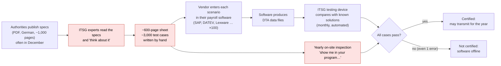
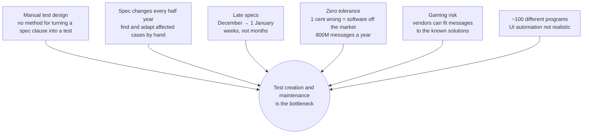
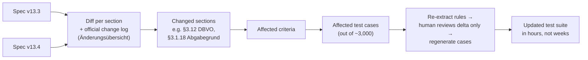
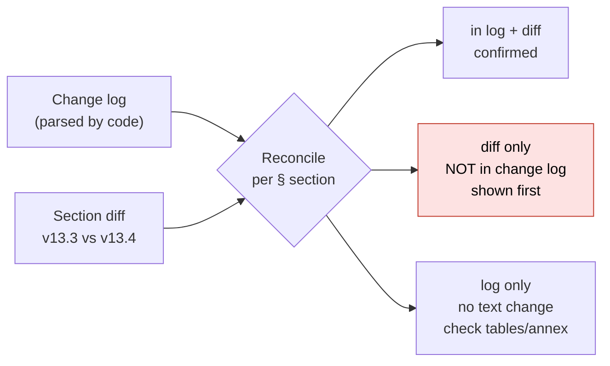
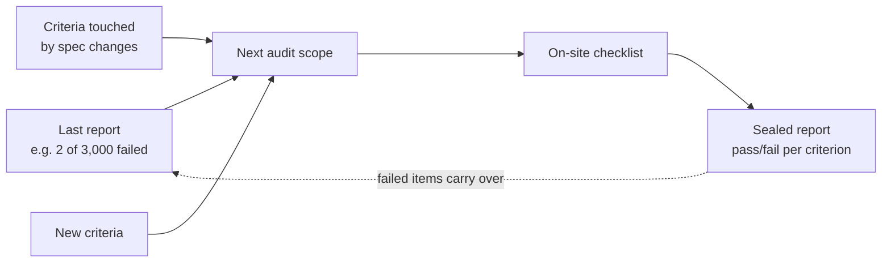
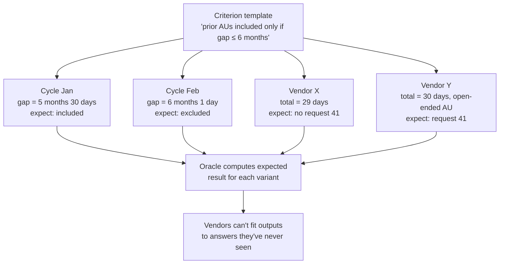
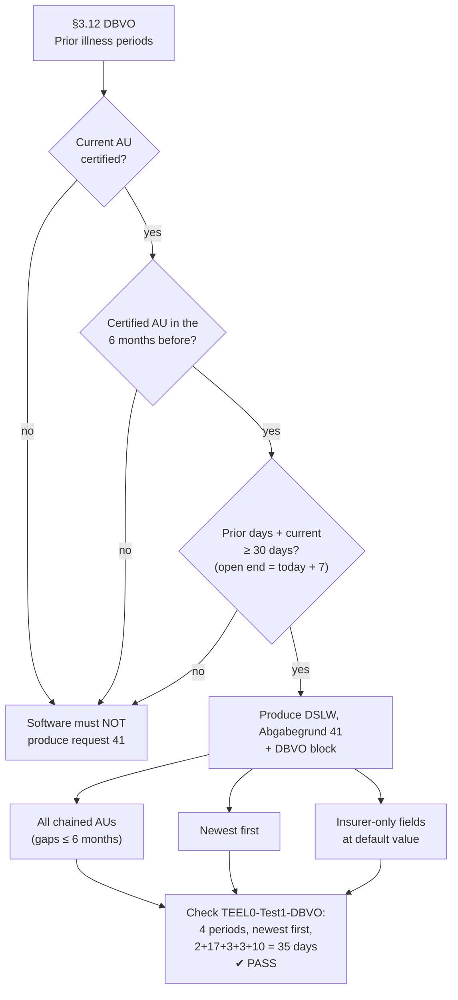
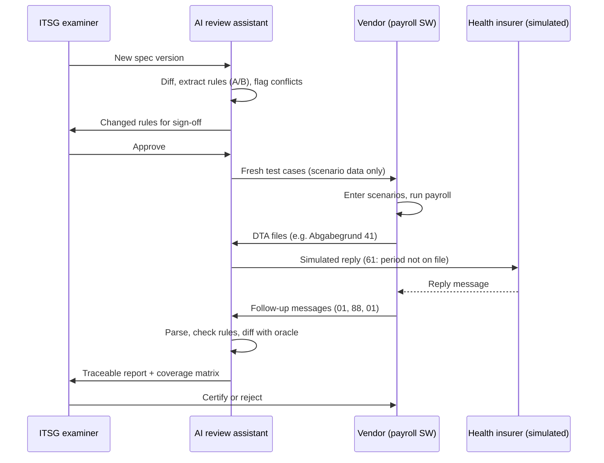

# Problem and Solution at a Glance

Background: [01-challenge-overview.md](01-challenge-overview.md), [07-itsg-meeting-notes.md](07-itsg-meeting-notes.md),
[06-solution-concept.md](06-solution-concept.md).

## The problem

Every payroll program in Germany (~100 of them) has to be certified by ITSG every year before it may
send reports to the social insurers. ITSG checks each one against **~3,000 test cases that are
written and maintained by hand** from **~1,000 pages of German specification**. The specs change
every half year, often arriving in December and taking effect on 1 January. The tolerance for error
is **zero**: one wrong field or one wrong cent, and the software is off the market.

### How it works today

Red marks the manual steps that hurt most.

### Where it hurts

## The solution: an AI review assistant

**Core idea: use the LLM where understanding is needed, and deterministic code where proof is
needed.** The AI reads the specs and drafts rules, each with a citation. A person approves each rule
once. From then on, code generates the test cases, computes the expected results and checks the
vendor's output. The LLM never decides whether something passes.

### End-to-end pipeline

```mermaid
flowchart LR
    subgraph IN["1 · Specs"]
        S["Verfahrensbeschreibung<br/>GG · Circulars · Beispielpapier"]
    end

    subgraph AI["2 · AI extraction"]
        X1["LLM extraction A"]
        X2["LLM extraction B<br/>(other model or prompt)"]
        CMP{"A = B?"}
    end

    subgraph HUMAN["3 · Human sign-off"]
        H["Examiner approves rule<br/>once, not 3,000 cases"]
    end

    subgraph CAT["4 · Criteria catalogue"]
        C["Rule · §-citation · UUID<br/>gate / content / format<br/>executable check"]
    end

    subgraph GEN["5 · Test generation"]
        G["Scenarios: positive,<br/>negative, boundary"]
        O["Deterministic oracle<br/>computes expected records"]
    end

    subgraph RUN["6 · Vendor"]
        V["Runs cases in payroll SW<br/>→ DTA files"]
    end

    subgraph VAL["7 · Validation"]
        P["Fixed-width parser"]
        R["Rule engine +<br/>expected vs. actual diff"]
    end

    subgraph OUT["8 · Report"]
        REP["Traceable report<br/>criterion → test → field →<br/>verdict → § citation<br/>+ product and version ID"]
    end

    S --> X1 & X2 --> CMP
    CMP -- yes --> H
    CMP -- "no: flag" --> H
    H --> C --> G --> O --> V --> P --> R --> REP
    O -. expected .-> R
```

### Killer feature 1: spec change → updated test cases

When a new spec version arrives, we don't start over. We work out what changed, and only that goes
to a person.

The government doesn't always ship a change log, so both sources run, and every change gets a
source badge:

### Next audit scope: failed + changed + new

ITSG doesn't re-check all ~3,000 criteria every year (ITSG engineer, 26.10.2026).

### Killer feature 2: fresh variants against gaming

Each criterion is a **template**, not a fixed answer. Every test cycle, or every vendor, gets new
concrete data that still sits on the boundaries. The expected result is recomputed each time.

### Worked example: the prior-illness request (DBVO, Abgabegrund 41)

This is the one case ITSG worked out for us ([04-example-test-case-dbvo.md](04-example-test-case-dbvo.md)).
It shows how a single spec section becomes a gate check and content checks, and then a verdict on
the real sample file.

### How a test flows between the parties

## Why this fits what ITSG asked for

| ITSG objective | How we cover it |
|---|---|
| Identify requirements | LLM extraction from the specs, two independent runs, with citations |
| Translate into testable criteria | Criteria catalogue: gate, content and format checks, executable |
| Generate test cases with expected results | Generator plus deterministic oracle; positive, negative and boundary cases; fresh variants |
| Create a traceable test record | Every verdict linked to criterion, test case, field and § citation |
| Test and compare | Fixed-width parser, rule engine, and field-level diff of expected vs. actual |
| Deliver comprehensible reports | Report and coverage view; the LLM explains failures in plain language |
| *(From the meeting)* Spec changes | Diff → affected criteria → affected tests → regenerated tests |
| *(From the meeting)* Zero tolerance | LLM never decides a pass; dual extraction; human sign-off per rule |
| *(From the meeting)* Gaming | Fresh variants each cycle |
